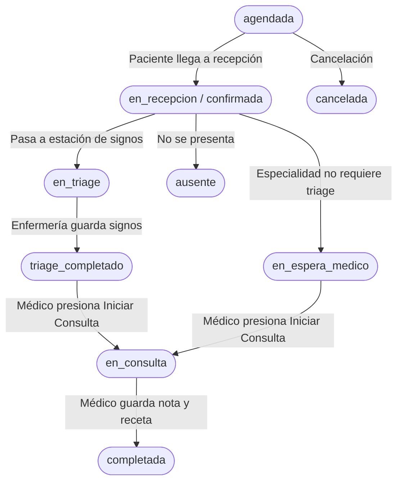

# Dossier de Arquitectura, Estado Actual y Guía Técnica del Proyecto
## Gestor Citas — Words of Hope (Centro Comunitario de Salud · Módulo 1)

> **PROPÓSITO DE ESTE DOCUMENTO**:
> Este archivo condensa todo el contexto arquitectónico, técnico, clínico y operativo del proyecto. Ha sido diseñado específicamente para ser compartido con Inteligencias Artificiales en entornos de desarrollo conversacional (copiando/pegando partes o el documento completo), de modo que la IA adquiera inmediatamente un entendimiento profundo del sistema, su deuda técnica, sus convenciones y sus reglas de oro, sin requerir acceso directo al repositorio completo.

---

## 1. Ficha Técnica y Resumen General del Sistema

- **Nombre del Proyecto**: Gestor Citas - Words of Hope (`GestorCitas_WordsOfHope` / Módulo 1).
- **Misión Clínica**: Sistema integral para la operación de centros y jornadas comunitarias de salud en zonas vulnerables (ej. Sonoyta, Puerto Peñasco, etc.). Permite gestionar eventos médicos, especialidades con capacidad multi-médico, bloques horarios dinámicos (N pacientes por M médicos), recepción y check-in, estación de triaje (signos vitales), consulta médica (diagnósticos CIE, notas SOAP, recetas y estudios), quirófanos/cirugías, seguimientos post-atención y auditoría clínica legal.
- **Roles de Usuario y Permisos**:
  1. `recepcion`: Agendamiento de citas, control de asistencia (check-in), reasignaciones, cancelaciones y vista de calendario.
  2. `triage`: Enfermería; captura de signos vitales (presión, frecuencia, glucosa, oximetría, peso, talla), razón de consulta y derivación a cola de espera.
  3. `medico`: Consulta clínica, revisión de signos vitales capturados en triaje, redacción de diagnóstico/recetas/estudios, revisión de historial médico previo.
  4. `administrador`: Control total del sistema: gestión de usuarios y vigencias, configuración de sedes, eventos clínicos, catálogo de especialidades y bitácora de auditoría.

---

## 2. Stack Tecnológico y Entorno de Ejecución

### Frontend
- **Librería Core**: React 18 con TypeScript (`.tsx`, `.ts`).
- **Empaquetador**: Vite 6.
  - **Base URL obligatoria**: `/citas/` (configurada en `vite.config.ts`; todos los assets y rutas se sirven bajo este prefijo).
  - **Proxy de Desarrollo**: Rutas `/api` redirigen a `http://127.0.0.1:3001`.
  - **Alias de Importación**: `@/*` apunta a `./src/*`.
  - **Puerto de desarrollo**: 5000 (`http://localhost:5000/citas/`).
- **Enrutamiento**: React Router 7 (`createBrowserRouter` con `RootLayout`).
- **Estilos & UI**:
  - Tailwind CSS v4 (vía `@tailwindcss/vite`).
  - Primitivas de accesibilidad: Radix UI (`@radix-ui/*`).
  - Iconografía: `lucide-react`.
  - Componentes de calendario: FullCalendar v6 (`@fullcalendar/react`, `@fullcalendar/timegrid`, etc.).
  - Componentes complementarios: PrimeReact.

### Backend
- **Framework**: Express.js 5 sobre Node.js con módulos ECMAScript nativos (`"type": "module"` en `package.json`).
- **Puerto del Servidor**: 3001 (`process.env.PORT || 3001`).
- **Base de Datos**: PostgreSQL conectada mediante pool de conexiones `pg`.
  - **Esquema de BD**: `citas`.
- **Sincronización en Tiempo Real**: Server-Sent Events (SSE) servido en `/api/sse`, conectado al mecanismo `LISTEN/NOTIFY` de PostgreSQL (`server/helpers/db-notify.js`). Notifica en vivo altas, bajas y cambios en citas, triajes y consultas.
- **Autenticación & Seguridad**: Cifrado de credenciales con `bcryptjs`.
- **Migraciones en Caliente**: Ejecutadas automáticamente al arrancar el servidor (`server/index.js` -> `server/helpers/migrations.js`). Garantizan que triggers, columnas nuevas y unificación de datos se apliquen sin scripts manuales.

### Variables de Entorno Clave (`.env`)
```env
DB_USER=admin_citas
DB_PASSWORD=*****
DB_HOST=wordsofhope.dyndns.org
DB_PORT=5432
DB_NAME=centro_comunitario
DB_SCHEMA=citas
PORT=3001
VITE_API_PORT=3001
EVENTOS_MODO_PRUEBAS=true
VITE_EVENTOS_MODO_PRUEBAS=true
```

### Comandos de Desarrollo
```bash
npm run dev        # Ejecuta concurrently: Frontend (Vite :5000) + Backend (Node :3001 con --watch)
npm run frontend   # Solo frontend
npm run backend    # Solo backend
npm run typecheck  # Validación estricta de TypeScript (tsc --noEmit) -> DEBE terminar con exit code 0
npm run build      # Compilación de producción con Vite
```

---

## 3. Estado Actual de la Implementación (Qué Funciona)

El sistema se encuentra en un estado funcional avanzado ("feature-complete" para el flujo clínico operativo esencial). Se completaron las 8 etapas del plan combinado y la sincronización Triage-Médico:

1. **Autenticación y Sesión**: Inicio de sesión validado contra base de datos con contraseñas en `bcrypt`, selector de rol activo y selector de sede/ciudad para personal itinerante.
2. **Gestión de Eventos y Jornadas**:
   - Creación de eventos clínicos comunitarios con rango de fechas y sedes.
   - Configuración de especialidades por evento, asignación de médicos (soporta pools multi-médico) y practicantes.
   - Definición de bloques horarios N:M (cupos de pacientes por bloque e intervalos en minutos).
3. **Agendamiento y Recepción (`/citas`)**:
   - Registro de pacientes nuevos y búsqueda predictiva de existentes.
   - Agendamiento en bloques de evento o citas generales.
   - Vista en lista y vista en calendario FullCalendar.
   - Acciones operativas: cambio de estado, check-in de llegada (`en_recepcion`), cancelación, reasignación.
4. **Estación de Triaje (`/triage`)**:
   - Cola de pacientes llegados que requieren triaje.
   - Captura de signos vitales: temperatura (°C), presión arterial (sistólica/diastólica), frecuencia cardíaca, frecuencia respiratoria, saturación O₂, glucosa en sangre (mg/dL), peso (kg) y talla (cm).
   - Captura de la **razón / motivo de consulta** y observaciones.
   - Transición de estado de la cita a `triage_completado`.
   - Cola de asignación de médico disponible (`AsignacionMedicoQueue.tsx`).
5. **Consulta Médica (`/medico`)**:
   - Lista de espera del médico asignado con badges de estado y pre-visualización de signos vitales.
   - Botón "Iniciar Consulta": transiciona la cita a `en_consulta` y bloquea la atención concurrente.
   - **Recepción reactiva de Triaje**: Lee directamente los signos vitales tomados en enfermería y prellena el motivo de consulta. Si una cita no requirió triaje o no lo tiene, muestra un aviso explícito en lugar de ocultarse.
   - Formulario de consulta clínica: Padecimiento actual, exploración física, diagnóstico con búsqueda CIE-10/CIE-11, plan de tratamiento, recetas médicas estructuradas y solicitud de estudios.
   - Finalización de consulta: guarda en `citas.consultas`, consolida en `citas.expediente` y cambia la cita a `completada`.
6. **Expedientes Clínicos (`/expedientes`, `/expediente/:pacienteId`)**:
   - Vista global por paciente con pestañas de Resumen, Citas históricas y Detalle de Consulta.
   - Componente reutilizable `DetalleCitaCompleta.tsx` para auditoría retrospectiva de cada cita.
7. **Cirugías y Seguimientos (`/cirugias`, `/seguimientos`)**:
   - Programación de procedimientos en quirófanos propios o sedes subrogadas.
   - Notas pre y postoperatorias.
   - Tablero de seguimiento de pacientes postquirúrgicos con **semáforo de riesgo** (urgencia basada en fechas de contacto vs fecha actual).
8. **Administración & Auditoría (`/usuarios`, `/variables`, `/auditoria`)**:
   - ABM de usuarios con control de vigencias temporales (ideal para brigadas voluntarias).
   - Catálogo de ciudades y especialidades médicas.
   - Registro inmutable de auditoría para trazabilidad de cada acción crítica.

---

## 4. Mapa de la Estructura de Archivos del Proyecto

```
MODULO 1/
├── audits/                     # Registros y evidencias de etapas de migración previas
├── dist/                       # Artefactos de build de Vite
├── docs/                       # Documentación adicional del proyecto
├── server/                     # Backend Node.js / Express
│   ├── config/
│   │   └── db.js               # Pool de conexiones PostgreSQL (pg)
│   ├── helpers/
│   │   ├── db-notify.js        # Listener LISTEN/NOTIFY para disparar SSE
│   │   ├── migrations.js       # Migraciones automáticas de esquema y datos
│   │   ├── sse.js              # Gestor de conexiones Server-Sent Events (/api/sse)
│   │   └── utils.js            # Mapeadores BD -> API (mapCita, mapTriage, mapPaciente, etc.)
│   ├── routes/                 # Endpoints REST de la API
│   │   ├── auditoria.js        # Logs de auditoría
│   │   ├── cirugias.js         # Procedimientos quirúrgicos y quirófanos
│   │   ├── citas.js            # CRUD y transiciones de estado de citas (~750 líneas)
│   │   ├── ciudades.js         # Catálogo de ciudades/sedes
│   │   ├── consultas.js        # Registro de consultas médicas
│   │   ├── especialidades.js   # Catálogo de especialidades
│   │   ├── estudios.js         # Catálogo y solicitud de estudios médicos
│   │   ├── eventos.js          # CRUD de eventos, especialidades y bloques (~794 líneas)
│   │   ├── expediente-captura.js # Endpoints avanzados de guardado de expediente clínico
│   │   ├── expediente-cita.js  # Relación expediente-cita
│   │   ├── expediente.js       # Consultas de expediente histórico
│   │   ├── export.js           # Exportación de datos
│   │   ├── informacion-medica.js # Antecedentes patológicos del paciente
│   │   ├── pacientes.js        # CRUD y búsqueda de pacientes
│   │   ├── sedes.js            # Sedes quirúrgicas
│   │   ├── seguimientos.js     # Seguimiento postoperatorio y llamadas
│   │   ├── triage.js           # Captura y consulta de triajes
│   │   ├── upload.js           # Subida de archivos médicos
│   │   └── usuarios.js         # Usuarios, autenticación y contraseñas
│   ├── index.js                # Punto de entrada Express y orquestador de middlewares
│   └── package.json            # Dependencias del servidor
├── src/                        # Frontend React + TypeScript
│   ├── app/
│   │   ├── components/         # Componentes UI reutilizables y modales
│   │   │   ├── cirugias/       # Modales de cirugías (Nueva, Detalle, Postoperatoria, Alta)
│   │   │   ├── citas/          # Calendario de citas del día
│   │   │   ├── dashboard/      # Tarjetas de bienvenida y estadísticas por rol
│   │   │   ├── eventos/        # Editores de eventos, especialidades, matrices y bloques
│   │   │   ├── expediente/     # Ficha de paciente, signos vitales, detalle completo de cita
│   │   │   ├── medico/         # Editores de datos generales e info médica
│   │   │   ├── pacientes/      # Diálogo para alta rápida de pacientes
│   │   │   ├── triage/         # Cola de asignación a médico
│   │   │   ├── ui/             # Componentes base Radix/Tailwind (button, dialog, card, etc.)
│   │   │   ├── DashboardAdmin.tsx
│   │   │   ├── DashboardLayout.tsx
│   │   │   ├── DashboardMedico.tsx
│   │   │   ├── DashboardRecepcion.tsx
│   │   │   ├── DashboardTriage.tsx
│   │   │   ├── ExpedienteCompleto.tsx
│   │   │   ├── Login.tsx
│   │   │   └── RootLayout.tsx
│   │   ├── context/            # Estado global con React Context
│   │   │   ├── AuthContext.tsx     # Usuario actual, rol, ciudad activa, login/logout
│   │   │   ├── DataContext.tsx     # MEGA-CONTEXTO: citas, pacientes, triajes, consultas (~928 líneas)
│   │   │   └── LanguageContext.tsx # i18n incrustado en código (~1,226 líneas)
│   │   ├── pages/              # Vistas principales vinculadas a rutas
│   │   │   ├── expediente/     # ExpedienteResumen, ExpedienteCitas, ExpedienteCitaDetalle
│   │   │   ├── pacientes/      # importarexpedientepage.tsx (~1,507 líneas)
│   │   │   ├── AgendaQuirofanos.tsx
│   │   │   ├── Auditoria.tsx
│   │   │   ├── Cirugias.tsx
│   │   │   ├── Citas.tsx
│   │   │   ├── Consultas.tsx
│   │   │   ├── Dashboard.tsx
│   │   │   ├── EventoDetalle.tsx
│   │   │   ├── EventoEditor.tsx
│   │   │   ├── Eventos.tsx
│   │   │   ├── ExpedientePaciente.tsx
│   │   │   ├── Expedientes.tsx
│   │   │   ├── Medico.tsx      # MEGA-COMPONENTE de consulta médica (~1,787 líneas)
│   │   │   ├── Pacientes.tsx
│   │   │   ├── Seguimientos.tsx # MEGA-COMPONENTE de seguimientos (~1,300 líneas)
│   │   │   ├── TriageNuevo.tsx # Vista de toma de signos vitales (~796 líneas)
│   │   │   ├── Usuarios.tsx    # Gestión de usuarios (~787 líneas)
│   │   │   └── Variables.tsx   # Configuración de catálogos
│   │   ├── utils/              # Funciones auxiliares
│   │   │   ├── ciudades.ts
│   │   │   ├── clock.ts        # Manejo consistente de fechas ISO / YMD
│   │   │   ├── especialidades.ts
│   │   │   ├── eventoEstado.ts
│   │   │   ├── featureFlags.ts
│   │   │   └── triageAccess.ts
│   │   ├── routes.ts           # Definición de rutas React Router 7
│   │   └── types.ts            # Definiciones de TypeScript unificadas (~516 líneas)
│   ├── styles/                 # Configuración de Tailwind CSS y fuentes
│   ├── main.tsx                # Montaje de la app en el DOM
│   └── vite-env.d.ts
├── .env                        # Variables de entorno
├── AGENTS.md                   # Reglas de desarrollo para agentes
├── package.json                # Dependencias raíz y scripts
├── tsconfig.json               # Configuración de TypeScript
└── vite.config.ts              # Configuración de Vite
```

---

## 5. Diagnóstico de Cumplimiento Arquitectónico y Deuda Técnica

### ¿Cumplen los archivos con la estructura ideal del proyecto?
**NO de manera óptima.** Aunque el sistema funciona correctamente y compila sin errores de TypeScript, sufre de una **alta deuda técnica por acoplamiento y archivos monolíticos ("God Files")**. Esto dificulta el mantenimiento cuando no se tiene un agente con ventana de contexto infinita.

### Hallazgos Críticos de Deuda Técnica:

| Archivo | Tamaño / Líneas | Problema Arquitectónico Principal |
| :--- | :--- | :--- |
| `src/app/pages/Medico.tsx` | **1,787 líneas** (99 KB) | **God Component**: Mezcla cola de espera, temporizador de consulta, formulario de exploración, visor de triaje, buscador CIE, editor de recetas, solicitud de estudios y modales en una sola vista. |
| `src/app/pages/pacientes/importarexpedientepage.tsx` | **1,507 líneas** (71 KB) | Lógica de parsing CSV, mapeo de columnas, validaciones, visualización previa y peticiones HTTP masivas sin separación. |
| `src/app/pages/Seguimientos.tsx` | **1,300 líneas** (69 KB) | Múltiples modales incrustados, lógica de semáforos, gestión de llamadas telefónicas y estados locales complejos sin modularizar. |
| `src/app/context/LanguageContext.tsx` | **1,226 líneas** (62 KB) | **Diccionario i18n incrustado en código**: Los textos en español e inglés están declarados dentro del propio archivo de Contexto en lugar de archivos JSON externos. |
| `src/app/context/DataContext.tsx` | **928 líneas** (37 KB) | **Monolito de Estado**: Agrupa 15 entidades distintas (citas, pacientes, usuarios, eventos, triajes, consultas, seguimientos, cirugías, sedes). Un cambio en una cita puede provocar renders innecesarios en toda la app. |
| `src/app/pages/EventoDetalle.tsx` | **809 líneas** (41 KB) | Contiene la visualización de la agenda, slots, asignación y cálculo de capacidad en el mismo componente. |
| `src/app/pages/TriageNuevo.tsx` | **796 líneas** (38 KB) | Lógica de captura de signos vitales, validación de rangos clínicos, cola de pacientes y llamadas de guardado mezcladas. |
| `server/routes/eventos.js` | **794 líneas** (34 KB) | Falta de capa de servicio: SQL crudo (`pool.query`) embebido directamente en las rutas de Express con validaciones anidadas. |
| `server/routes/citas.js` | **750 líneas** (34 KB) | Transiciones de estado complejas, bloqueos de concurrencia y consultas SQL directas en los controladores HTTP. |

### Otros Problemas Detectados:
1. **Falta de un Cliente API Centralizado (API Services)**: En el frontend, las llamadas `fetch('/api/...')` se realizan directamente dentro de `DataContext.tsx` o en páginas específicas, repitiendo lógica de `try/catch` y manejo de headers.
2. **Discrepancia en Tipos de Claves Primarias (`string` vs `number`)**: PostgreSQL almacena `id_cita` e `id_paciente` como `INTEGER`. El backend a veces los serializa como `string` o `number`, provocando que comparaciones estrictas (`cita.id === selectedId`) fallen si no se fuerzan con `String(...)`.
3. **Falta de Capa de Servicios en Backend**: No hay separación entre `Routes` -> `Controllers` -> `Services` -> `Database Queries`. Todo está mezclado en los archivos dentro de `server/routes/`.

---

## 6. Plan Detallado de Refactorización y Separación Recomendada

Para que cualquier desarrollador o IA pueda abordar mejoras sin romper la aplicación, se debe seguir la siguiente estrategia de separación:

### A. Modularización de `Medico.tsx` (Prioridad Alta)
Dividir el archivo de 1,787 líneas en componentes especializados dentro de `src/app/components/medico/`:
1. `src/app/components/medico/ColaEsperaMedico.tsx`: Tabla y filtros de pacientes en espera (`en_consulta`, `triage_completado`).
2. `src/app/components/medico/PanelSignosTriaje.tsx`: Tarjeta visual con la información capturada por enfermería (signos, IMC, motivo de triaje).
3. `src/app/components/medico/FormularioNotaClinica.tsx`: Campos de exploración física, padecimiento actual y buscador de diagnósticos CIE.
4. `src/app/components/medico/PrescripcionYEstudios.tsx`: Sección para agregar medicamentos y órdenes de laboratorio/gabinete.
5. `src/app/hooks/useConsultaActiva.ts`: Custom hook que encapsule el temporizador, el guardado automático y la lógica de cierre de la consulta.

### B. Modularización de `DataContext.tsx` (Prioridad Alta)
Dividir el monolito de 928 líneas en contextos temáticos o tiendas más atómicas:
- `CitasContext.tsx`: Citas activas, estados, agendamiento y SSE de citas.
- `PacientesContext.tsx`: Pacientes y búsqueda predictiva.
- `EventosContext.tsx`: Eventos, bloques horarios y especialidades.
- `CatalogosContext.tsx`: Ciudades, especialidades del sistema y sedes.

### C. Desacoplamiento de `LanguageContext.tsx`
- Extraer los literales a archivos estáticos:
  - `src/locales/es.json`
  - `src/locales/en.json`
- `LanguageContext.tsx` debe limitarse a leer el JSON seleccionado y proveer la función `t(clave)`.

### D. Refactorización del Backend (`server/`)
Introducir una arquitectura limpia de 3 capas:
```
server/
├── controllers/    # Funciones (req, res): validación de entrada y códigos HTTP
├── services/       # Reglas de negocio (cálculo de cupos, validación de estados)
├── repositories/   # Consultas SQL directas a PostgreSQL (pool.query)
└── routes/         # Definición limpia de rutas Express vinculadas a controllers
```

---

## 7. Modelo de Datos y Máquina de Estados

### Tablas Principales en PostgreSQL (Esquema `citas`)
- `citas`: Contiene la cita clínica (`id_cita`, `id_paciente`, `fecha_cita`, `hora`, `especialidad`, `estado`, `medico_encargado`, `id_bloque`, etc.).
- `pacientes`: Ficha demográfica (`id_paciente`, `nombre`, `apellidos`, `fecha_nacimiento`, `telefono`, `curp`, `ciudad_origen`, etc.).
- `triaje`: Registro de signos vitales (`id_triaje`, `id_cita`, `id_paciente`, `temperatura`, `presion_arterial`, `ritmo_cardiaco`, `frec_respiratoria`, `oxigenacion`, `glucosa`, `peso`, `altura`, `razon_consulta`, `observaciones`).
- `consultas`: Nota médica de la cita (`id_consulta`, `id_cita`, `id_paciente`, `diagnostico`, `subjetivo`, `objetivo`, `plan`, `receta_json`, `estudios_json`).
- `expediente`: Tabla histórica consolidada que vincula atenciones previas de cada paciente.
- `eventos` y `evento_especialidad`: Eventos comunitarios, configuración de consultorios, médicos y capacidad.
- `usuarios`: Cuentas del personal (`id_usuario`, `nombre`, `email`, `password_hash`, `rol`, `ciudades`, `especialidades`, `activo_desde`, `activo_hasta`).
- `auditoria`: Trazabilidad inmutable de altas, bajas y modificaciones.

### Ciclo de Vida y Transiciones de una Cita (`estado`)


---

## 8. Manual de Operación para la Inteligencia Artificial Receptora

Si eres una IA a la que se le ha compartido este documento junto con un fragmento de código o una tarea específica, **debes seguir estrictamente estas reglas**:

1. **Regla de Comparación de IDs**:
   - NUNCA asumas que un ID es estrictamente numérico o texto. Siempre compara usando conversión defensiva:
   ```typescript
   String(item.id) === String(targetId)
   ```
2. **Respetar la Base URL de Vite**:
   - Todo enlace interno o asset estático debe ser relativo o respetar la base `/citas/`.
3. **Mapeo Backend-Frontend (`utils.js`)**:
   - El backend mapea columnas de base de datos snake_case a camelCase para el frontend (ej. `razon_consulta` -> `razonConsulta`, `presion_arterial` -> `signosVitales.presionArterial`). Al agregar nuevos campos en base de datos, DEBES actualizar tanto la consulta SQL como la función de mapeo correspondiente en `server/helpers/utils.js`.
4. **Verificación de Tipos Obligatoria**:
   - Cualquier cambio en TypeScript debe respetar las interfaces de `src/app/types.ts`. Antes de dar una tarea por terminada, se debe verificar que `npm run typecheck` (`tsc --noEmit`) no arroje ningún error.
5. **No introducir "Breaking Changes" en Flujos Operativos**:
   - Si trabajas en el módulo médico, asegúrate de no romper la recepción de datos provenientes de triaje (`selectedCita.triage`).
   - Si trabajas en eventos, recuerda que existen especialidades con multi-médico y especialidades que marcan `requiereTriage: false`.

### Matriz de Archivos a Solicitar según la Tarea:
Cuando el usuario te pida trabajar en una parte del sistema, pídele únicamente los archivos relevantes de esta lista para no saturar el contexto:

- **Si vas a trabajar en Triaje o Signos Vitales**:
  - `src/app/pages/TriageNuevo.tsx`
  - `server/routes/triage.js`
  - `server/helpers/utils.js` (función `mapTriage`)
- **Si vas a trabajar en Consulta Médica**:
  - `src/app/pages/Medico.tsx`
  - `src/app/components/triage/AsignacionMedicoQueue.tsx`
  - `server/routes/consultas.js`
- **Si vas a trabajar en Citas o Recepción**:
  - `src/app/pages/Citas.tsx`
  - `src/app/components/eventos/AgendarCitaDialog.tsx`
  - `server/routes/citas.js`
- **Si vas a trabajar en Eventos o Bloques Horarios**:
  - `src/app/pages/EventoEditor.tsx`
  - `src/app/components/eventos/EspecialidadCardEditor.tsx`
  - `server/routes/eventos.js`
- **Si vas a trabajar en Expedientes Clínicos**:
  - `src/app/components/expediente/DetalleCitaCompleta.tsx`
  - `src/app/pages/expediente/ExpedienteCitaDetalle.tsx`
  - `server/routes/expediente-captura.js`
- **Si vas a trabajar en Usuarios o Permisos**:
  - `src/app/pages/Usuarios.tsx`
  - `src/app/context/AuthContext.tsx`
  - `server/routes/usuarios.js`

